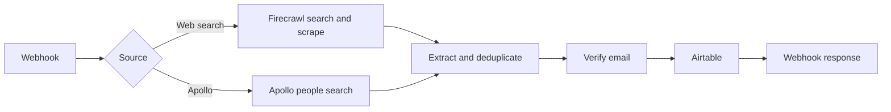

# n8n Lead Generation System

An n8n workflow for collecting, deduplicating, enriching, and validating B2B leads for **Example Brand**. It has separate web-search and Apollo paths and stores results in Airtable.

> Private project. This is a sanitized snapshot, not a live sync with n8n Cloud. Restore product-specific search examples before use.

## What it does

- **Web-search path:** Generates search variations, searches and scrapes with Firecrawl, extracts lead details, verifies email addresses with Reoon, deduplicates results, and writes records to Airtable.
- **Apollo path:** Searches people, reveals contact data, deduplicates and validates records, then writes valid and invalid results to Airtable.
- **Webhook responses:** Returns results or counts to the caller through dedicated response nodes.

The export contains 50 nodes. [`workflow.json`](workflow.json) is the source of truth for configuration.

## Repository contents

- [`workflow.json`](workflow.json) - sanitized n8n export.
- [`docs/setup.md`](docs/setup.md) - required credentials and import checks.
- [`docs/operations.md`](docs/operations.md) - monitoring and troubleshooting.
- [`SECURITY.md`](SECURITY.md) - secret-handling guidance.

## Before activation

The export has four credential locations replaced with `REPLACE_WITH_API_KEY`: one Firecrawl Authorization header, one Reoon URL parameter, and two Apollo `X-Api-Key` headers. Reconnect the Airtable and Firecrawl n8n credentials as well. See the [setup guide](docs/setup.md) for the exact nodes.

Pinned execution data has been removed. Review webhook URLs, Airtable table mappings, and rate limits before enabling the imported workflow.

## Related workflow

Sending email to verified Apollo leads lives in the separate [Apollo outreach repository](https://github.com/aymanjamaly/n8n-outreach-automation).
